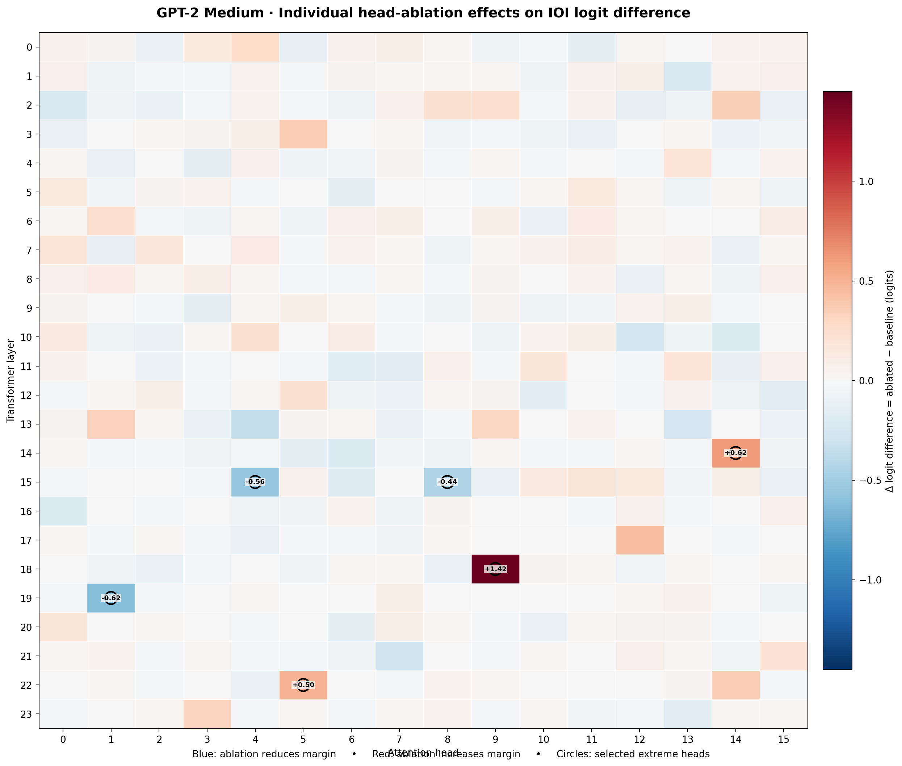

### Understanding Score Changes in Head Ablation

When we ablate an attention head and evaluate the logit difference, we compute:
$$\text{Score Change} = \text{Ablated Logit Difference} - \text{Baseline Logit Difference}$$

* **Negative Score Change (Performance Drops):** These heads are **critical** for performing the IOI task. When silenced, the model struggles to identify the correct name over the incorrect name. These typically represent **Name Movers** (which write the correct name's representation to the output token) or **S-Inhibition / Duplicate Token Heads**.
* **Positive Score Change (Performance Improves):** These heads are **inhibitors** or **Negative Name Movers**. They normally write features that push the model toward outputting the incorrect name (the duplicate subject). Silencing them actually makes the model more confident in predicting the correct name.

### Separating Critical and Inhibitory Attention Heads

We can separate the heads based on their behavior upon ablation:
1. **Critical Heads (Negative Change):** Removing them harms performance because they actively help solve the task (e.g., Name Movers).
2. **Inhibitory Heads (Positive Change):** Removing them improves performance because they oppose the correct answer (e.g., Negative Name Movers).

### Negative Name Movers

I would like to show you **L18H9** is critical to `GPT-2 medium` as Negative Name Mover head. You can examine it on the heatmap, **+1.42** the largest positive value. The ablation will help model to predict the correct name. 

`_Next Question: if the head is silenced then who is compensating over it?_ Please consider to the Notebook 2.`

Thanks for your time to see the Repo.
