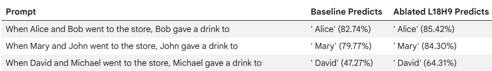

# Testing Backup Circuits
This repository is a series of understanding how does model perform compensatory computational pathways.

---
### Certain Findings in accordance of Activation Patching

* Ablating improves the circuit
* Ablating harms the circuit

To further seeing the model behavior, feel free to walk on establishing baseline head notebook.

GPT-2 Medium has an important component `L18H9` act as Negative Name Mover Head. It's ablation, actually helps model to behave correctly.

---

## Under Exploring Research Work.

A layer-wise method for characterizing the evolution of next-token predictions.

A causal evaluation of prediction changes following activation interventions.

A redundancy-aware framework for identifying compensatory components.

An investigation of whether early predictive signals are reinforced, suppressed or replaced by subsequent computation.
